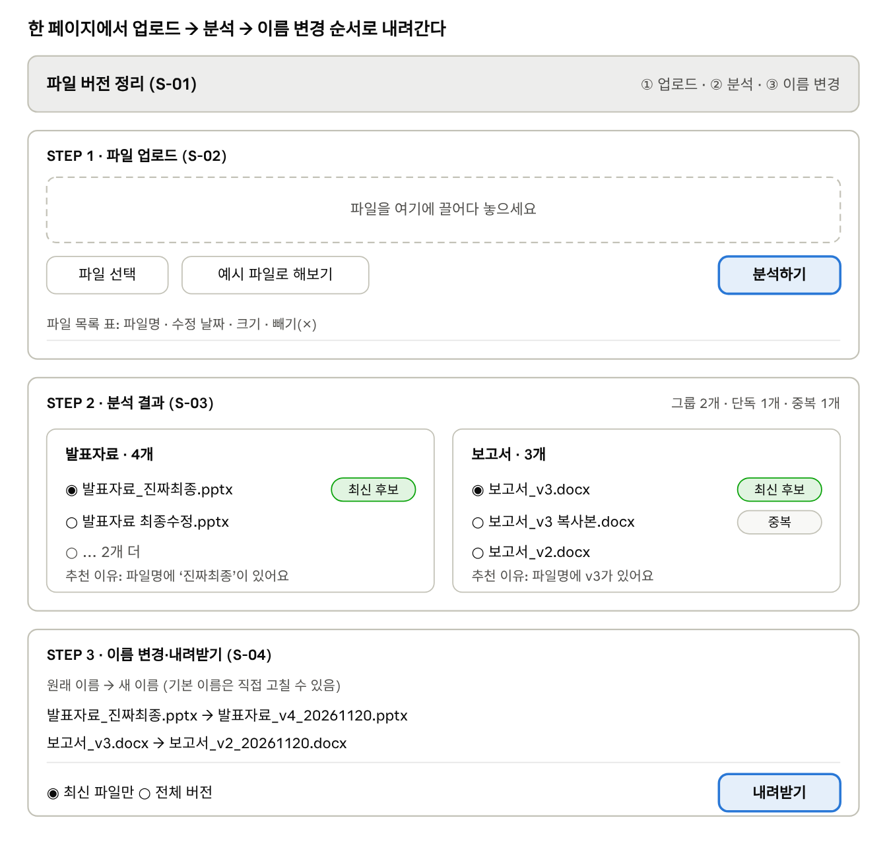

# 팀 프로젝트 파일 버전 관리 서비스 — 기능 명세서

2026-11-20 · 원본: 기능 명세서 최종본 DOCX를 마크다운으로 바꾼 것 (작성자 이름은 뺌)

## 1. 개요

여러 버전의 팀플 파일을 한 번에 올리면 비슷한 파일끼리 묶고, 최신 버전 후보와 중복 파일을 알려준 뒤, 규칙에 맞는 이름으로 바꿔서 내려받게 해주는 웹 서비스예요.

| 구분 | 내용 |
|---|---|
| 누가 | 카카오톡으로 파일을 주고받으며 팀플을 하는 대학생 |
| 무엇이 불편한가 | 최종, 수정본, 최종수정본처럼 이름이 비슷한 파일이 쌓여서 최신 파일을 찾으려면 수정 날짜와 대화 내용을 매번 확인해야 하고, 이전 버전으로 작업해 다시 하는 일도 생겨요 |
| 어떻게 해결하나 | 파일을 한 번에 올리면 파일명, 수정 날짜, 버전 표기를 비교해 최신 후보를 추천하고, 날짜와 버전 번호가 들어간 이름으로 바꿔줘요. Git 같은 도구를 배울 필요가 없어요 |

- 데이터: 가명과 예시 파일만 써요 (예: 발표자료_최종.pptx, 발표자료_최종_수정.pptx, 보고서_v2.docx).
- 원칙: 추천은 **후보**일 뿐이에요. 최종 선택은 사람이 확인하고 결정해요.

## 2. 필수 기능 3개

가이드 규칙이 **필수 기능 3개 이내**라서, 기획의 핵심 기능 5개를 사용 흐름에 맞춰 3개로 묶었어요. 기능을 빼지 않고 그대로 담았어요.

| 필수 기능 | 포함된 핵심 기능 | 시연에서 보이는 것 |
|---|---|---|
| ① 파일 업로드·목록 | 여러 파일 한 번에 업로드, 파일명·수정 날짜 확인 | 파일 8개를 끌어다 놓으면 표가 뜨는 화면 |
| ② 그룹 분류·최신 후보·중복 표시 | 비슷한 이름끼리 분류, 최신 버전 후보 추천, 내용이 같은 중복 파일 확인 | 그룹 카드마다 최신 후보와 중복 배지 |
| ③ 규칙 이름 변경·내려받기 | 날짜와 버전 번호를 포함한 파일명 변경 및 저장 | 바뀔 이름 미리보기 후 내려받기 |

**팀에서 정해야 할 것:** 시간이 부족하면 ②의 중복 표시를 ‘있으면 좋은 기능’으로 미룰지 미리 정해 두세요.

## 3. 기능 명세

필수 기능 3개를 세부 기능 18개로 나눠 정리했어요. 우선순위 **상**은 시연에 꼭 필요한 기능이고, **중**은 시간이 부족하면 단순하게 만들어도 되는 기능이에요.

### 3-1. 기능 목록

| 기능 ID | 분류 | 기능명 | 상세 동작 | 예외 처리 | 우선순위 |
|---|---|---|---|---|---|
| F-01-01 | ① 업로드·목록 | 파일 선택 업로드 | [파일 선택] 버튼으로 여러 파일을 한 번에 고른다. 이미 올린 목록에 추가된다 | 같은 파일(이름·크기·수정일 동일)을 다시 올리면 무시하고 안내한다 | 상 |
| F-01-02 | ① 업로드·목록 | 끌어다 놓기 업로드 | 파일을 업로드 영역에 끌어다 놓으면 F-01-01과 같게 처리한다. 끌고 있는 동안 영역 테두리를 강조한다 | 폴더를 놓으면 “파일만 올릴 수 있어요” 안내 | 중 |
| F-01-03 | ① 업로드·목록 | 예시 파일 불러오기 | [예시 파일로 해보기]를 누르면 준비된 가명 예시 파일 8개가 목록에 들어간다 | 기존 목록이 있으면 비울지 확인한다 | 상 |
| F-01-04 | ① 업로드·목록 | 파일 정보 읽기 | 파일마다 이름, 확장자, 크기, 수정 날짜를 읽는다 | 파일당 20MB를 넘으면 목록에서 빼고 이유를 표시한다. 확장자가 없으면 “확장자 없음”으로 처리한다 | 상 |
| F-01-05 | ① 업로드·목록 | 파일 목록 표시 | 파일명 · 수정 날짜 · 크기를 표로 보여주고, 제목을 누르면 그 열 기준으로 정렬한다. 표 위에 전체 파일 수를 표시한다 | 파일이 0개면 빈 상태 화면(M-01) | 상 |
| F-01-06 | ① 업로드·목록 | 파일 빼기 | 행의 [×]로 파일 하나를, [모두 지우기]로 전체를 목록에서 뺀다 | 분석 후에 빼면 분석 결과를 다시 계산한다 | 중 |
| F-02-01 | ② 분석 | 기본 이름 추출 | 파일명에서 버전 표현(3-2의 키워드·번호·날짜)과 공백·_·-·괄호를 지워 기본 이름을 만든다 | 다 지웠더니 빈 이름이 되면 원래 이름을 그대로 쓴다 | 상 |
| F-02-02 | ② 분석 | 그룹 분류 | 기본 이름과 확장자가 같은 파일끼리 묶는다. 그룹은 파일 수가 많은 순으로 보여준다 | 파일이 1개뿐인 그룹은 단독 파일(F-02-07)로 보낸다 | 상 |
| F-02-03 | ② 분석 | 버전 비교 | 그룹 안 파일을 3-2의 비교 순서(버전 번호 → 파일명 날짜 → 키워드 단계 → 수정 날짜)로 정렬한다 | 모든 기준이 같으면 동점으로 표시한다 | 상 |
| F-02-04 | ② 분석 | 최신 후보 추천 | 정렬 1위 파일에 “최신 후보” 배지와 추천 이유 한 줄을 붙인다 (예: “파일명에 v3가 있어요”) | 1위가 동점이면 “확인 필요” 배지를 붙이고 후보를 고르지 않는다 | 상 |
| F-02-05 | ② 분석 | 최신 파일 직접 선택 | 그룹마다 라디오 버튼으로 최신 파일을 바꿀 수 있다. 바꾸면 “직접 선택” 표시가 붙는다 | “확인 필요” 그룹을 고르지 않고 STEP 3으로 가면 M-05 안내 | 상 |
| F-02-06 | ② 분석 | 중복 파일 판별 | 파일 내용이 완전히 같으면 나중에 올린 파일에 “중복” 배지와 “OO와 내용이 같아요”를 표시한다. 그룹이 달라도 판별한다 | 이름이 같아도 내용이 다르면 중복이 아니다 | 중 |
| F-02-07 | ② 분석 | 단독 파일 처리 | 그룹에 속하지 않는 파일은 맨 아래 “단독 파일” 카드에 모아 보여준다 | — | 중 |
| F-03-01 | ③ 이름 변경 | 새 이름 만들기 | 기본이름_v번호_YYYYMMDD.확장자로 만든다. 번호는 그룹 안에서 오래된 순 1부터, 최신 파일이 가장 큰 번호. 날짜는 수정 날짜 | 단독 파일은 v1을 붙인다 | 상 |
| F-03-02 | ③ 이름 변경 | 변경 미리보기 | “원래 이름 → 새 이름” 표를 보여주고, 그룹의 기본 이름을 직접 고치면 그 그룹 새 이름이 바로 바뀐다 | 기본 이름을 비우면 M-06 안내 후 이전 이름으로 되돌린다 | 상 |
| F-03-03 | ③ 이름 변경 | 내려받을 범위 선택 | [최신 파일만] 또는 [전체 버전] 중 하나를 고른다. 기본값은 [최신 파일만]. 중복 파일은 항상 빠진다 | — | 상 |
| F-03-04 | ③ 이름 변경 | 내려받기 | 새 이름으로 된 사본을 내려받는다. 1개면 그 파일, 2개 이상이면 정리된파일_YYYYMMDD.zip 하나로 묶는다. 원본은 바뀌지 않는다 | 내려받을 파일이 0개면 버튼 비활성 | 상 |
| F-03-05 | ③ 이름 변경 | 이름 충돌·금지 문자 처리 | 새 이름이 겹치면 뒤에 _2, _3을 붙이고, 파일명에 쓸 수 없는 문자는 _로 바꾼다 | — | 중 |

### 3-2. 버전 판정 규칙

F-02-01, F-02-03이 쓰는 규칙이에요. 기준 1에서 결정되면 뒤 기준은 보지 않아요.

| 비교 순서 | 기준 | 인식하는 표현 | 비교 방법 |
|---|---|---|---|
| 1 | 버전 번호 | v2, V2, ver2 ((1), _1은 복사본 표시로 보고 제외) | 숫자가 클수록 최신. 없으면 0 |
| 2 | 파일명 날짜 | 1120, 20261120, 2026-11-20, 11.20 | 날짜가 늦을수록 최신 |
| 3 | 키워드 단계 | 진짜·찐최종 40 / 최종수정 30 / 최종·final·완성·제출 20 / 수정 10 / 없음 0 | 점수가 높을수록 최신 |
| 4 | 수정 날짜 | 파일 속성 | 늦을수록 최신. 카톡 파일은 저장 시각일 수 있어 마지막에만 쓴다 |

**판정 예시** (그룹 “발표자료”)

| 원래 이름 | 버전 번호 | 키워드 | 결과 | 새 이름 |
|---|---|---|---|---|
| 발표자료_진짜최종.pptx | 0 | 40 | 최신 후보 | 발표자료_v4_20261120.pptx |
| 발표자료 최종수정.pptx | 0 | 30 | — | 발표자료_v3_20261119.pptx |
| 발표자료_최종.pptx | 0 | 20 | — | 발표자료_v2_20261118.pptx |
| 발표자료(1).pptx | 0 (복사본 표시) | 0 | — | 발표자료_v1_20261117.pptx |

(1)을 버전 번호로 보면 기준 1에서 가장 높아져서, 카톡에서 같은 파일을 두 번 받았을 뿐인데 최신 후보가 돼요. 그래서 위 예시는 (1), _1을 복사본 표시로 보고 버전 번호에서 뺐어요. **이 방식으로 갈지 팀에서 확정해 주세요.**

## 4. 화면 명세 (UI/UX)

한 페이지 안에 STEP 3개 영역이 위에서 아래로 이어지는 구조예요. 로그인 없이 주소에 들어오면 바로 쓸 수 있어요.

화면 배치 와이어프레임 · S-01 ~ S-04

강조색 버튼이 각 단계의 주 버튼이에요. 그림 속 파일명은 3-2의 판정 예시를 따랐어요.

### 4-1. 화면 목록

| 화면 ID | 화면명 | 표시 조건 | 연결 기능 |
|---|---|---|---|
| S-01 | 상단 헤더·단계 표시 | 항상 | — |
| S-02 | STEP 1 파일 업로드 | 항상 | F-01-01 ~ F-01-06 |
| S-03 | STEP 2 분석 결과 | [분석하기]를 누른 뒤 | F-02-01 ~ F-02-07 |
| S-04 | STEP 3 이름 변경·내려받기 | [다음: 이름 바꾸기]를 누른 뒤 | F-03-01 ~ F-03-05 |

### 4-2. 화면별 UI 요소

**S-01 상단 헤더**

| No | 요소 | 유형 | 동작·표시 | 연결 기능 |
|---|---|---|---|---|
| 1 | 서비스 이름·한 줄 설명 | 텍스트 | “비슷한 파일을 올리면 최신 버전을 찾아 이름을 정리해 드려요” | — |
| 2 | 단계 표시 | 텍스트 | ① 업로드 · ② 분석 · ③ 이름 변경. 지금 단계를 굵게 표시하고, 누르면 해당 영역으로 스크롤 | — |

**S-02 STEP 1 파일 업로드**

| No | 요소 | 유형 | 동작·표시 | 연결 기능 |
|---|---|---|---|---|
| 1 | 드롭 영역 | 점선 영역 | 파일을 끌어다 놓으면 업로드, 누르면 파일 선택 창. 끌고 있는 동안 테두리 강조 | F-01-02 |
| 2 | [파일 선택] | 버튼 | 파일 선택 창 (여러 개 선택 가능) | F-01-01 |
| 3 | [예시 파일로 해보기] | 버튼 | 가명 예시 파일 8개를 목록에 넣음 | F-01-03 |
| 4 | 파일 수 | 텍스트 | “파일 8개” | F-01-05 |
| 5 | 파일 목록 | 표 | 열: 파일명 · 수정 날짜 · 크기 · [×]. 열 제목을 누르면 정렬 | F-01-05, F-01-06 |
| 6 | [모두 지우기] | 보조 버튼 | 목록 전체 비우기 | F-01-06 |
| 7 | [분석하기] | 주 버튼 | 파일 2개 이상일 때만 활성. 누르면 S-03을 표시하고 스크롤 | F-02-01 ~ F-02-07 |

**S-03 STEP 2 분석 결과**

| No | 요소 | 유형 | 동작·표시 | 연결 기능 |
|---|---|---|---|---|
| 1 | 요약 | 텍스트 | “그룹 2개 · 단독 1개 · 중복 1개” | F-02-02 |
| 2 | 그룹 카드 | 카드 | 제목 = 기본 이름 + 파일 수. 파일 수가 많은 그룹부터 | F-02-02 |
| 3 | 파일 행 | 행 | 라디오 버튼 · 파일명 · 수정 날짜 · 배지. 최신 순으로 정렬 | F-02-03 |
| 4 | 라디오 버튼 | 선택 | 최신 후보가 기본 선택. 바꾸면 “직접 선택” 표시 | F-02-05 |
| 5 | 배지 | 라벨 | 4-4 배지 정의대로 표시 | F-02-04, F-02-06 |
| 6 | 추천 이유 | 작은 텍스트 | 카드 아래 한 줄 (예: “파일명에 v3가 있어요”) | F-02-04 |
| 7 | 단독 파일 카드 | 카드 | 그룹 카드들 아래에 모아서 표시 | F-02-07 |
| 8 | [다음: 이름 바꾸기] | 주 버튼 | S-04 표시. “확인 필요” 그룹이 남아 있으면 M-05 | F-03-01 |

**S-04 STEP 3 이름 변경·내려받기**

| No | 요소 | 유형 | 동작·표시 | 연결 기능 |
|---|---|---|---|---|
| 1 | 기본 이름 입력칸 | 입력칸 | 그룹마다 1개. 고치면 미리보기가 바로 바뀜 | F-03-02 |
| 2 | 미리보기 표 | 표 | 열: 원래 이름 → 새 이름. 중복 파일은 회색으로 “제외” 표시 | F-03-01, F-03-05 |
| 3 | 범위 선택 | 라디오 | [최신 파일만] (기본) / [전체 버전] | F-03-03 |
| 4 | [내려받기] | 주 버튼 | 1개면 파일, 2개 이상이면 ZIP. 끝나면 M-08 | F-03-04 |
| 5 | [처음부터 다시] | 보조 버튼 | 목록과 결과를 비우고 S-02로 이동 | F-01-06 |

### 4-3. 화면 상태

| 상태 | 화면에 보이는 것 |
|---|---|
| 처음 (파일 0개) | S-01, S-02만. 드롭 영역에 M-01, [분석하기] 비활성 |
| 업로드 완료 | 파일 목록 표가 나타나고, 2개 이상이면 [분석하기] 활성 |
| 분석 중 | [분석하기] 자리에 “분석 중…” 표시, 버튼 비활성 |
| 분석 완료 | S-03 표시, 단계 표시가 ②로 바뀜 |
| 이름 변경 | S-04 표시, 단계 표시가 ③으로 바뀜 |

### 4-4. 배지 정의

| 배지 | 붙는 조건 | 색 |
|---|---|---|
| 최신 후보 | 그룹에서 비교 1위 (F-02-04) | 초록 |
| 확인 필요 | 1위가 동점이라 고를 수 없음 | 노랑 |
| 중복 | 다른 파일과 내용이 같음 (F-02-06) | 회색 |
| 직접 선택 | 사용자가 최신 파일을 바꿈 (F-02-05) | 파랑 |

### 4-5. 안내 메시지

| ID | 상황 | 문구 |
|---|---|---|
| M-01 | 파일 0개 | 파일을 여기에 끌어다 놓거나 [파일 선택]을 눌러 주세요 |
| M-02 | 파일 1개로 분석 | 비교하려면 파일이 2개 이상 필요해요 |
| M-03 | 크기 초과 | ‘파일명’은 20MB가 넘어서 빼고 올렸어요 |
| M-04 | 같은 파일 다시 올림 | 이미 올린 파일이에요 |
| M-05 | “확인 필요” 그룹이 남음 | 최신 파일을 골라야 하는 그룹이 N개 있어요 |
| M-06 | 기본 이름을 비움 | 기본 이름은 비워 둘 수 없어요 |
| M-07 | 폴더를 놓음 | 파일만 올릴 수 있어요 |
| M-08 | 내려받기 완료 | 파일 N개를 내려받았어요 |

### 4-6. UX 원칙

- 추천에는 항상 이유를 보여주고, 최종 선택은 사용자가 해요.
- 색만으로 구분하지 않고 배지에 글자를 함께 써요.
- 폰 화면(폭 480px 이하)에서는 그룹 카드를 한 줄에 하나씩, 파일 목록 표는 파일명과 수정 날짜만 보여줘요.
- 주 버튼은 한 영역에 하나만 두고 강조색을 써요.

## 5. 구현 시 주의할 점

- **카톡에서 받은 파일은 수정 날짜가 정확하지 않아요.** PC에 저장한 시각이 수정 날짜가 되는 경우가 많아서, 오래된 파일을 나중에 받으면 최신처럼 보여요. 그래서 추천은 파일명 정보를 먼저 보고, 수정 날짜는 마지막 기준으로만 써요. 발표에서 “할 수 있는 것만 약속한다”는 포인트로 설명하기 좋아요.
- **중복 비교는 주소가 http라는 점을 고려해야 해요.** 브라우저의 내장 해시 기능은 https나 localhost에서만 동작해서, http://공인IP 주소에서는 안 될 수 있어요. 서버에서 비교하거나 다른 방법을 써야 해서, 제작 담당과 미리 정해야 해요.
- **서버에 파일을 올릴 경우 업로드 크기 제한을 늘려야 해요.** 기본 제한이 1MB라 413 오류가 나요 (가이드 FAQ).
- **예시 파일만 써요.** 실제 팀플 자료나 개인정보가 들어간 파일은 시연에 쓰지 않아요.

**있으면 좋은 기능 (오늘은 만들지 않아요)**

- 팀원끼리 같은 목록을 보는 공유 폴더
- 이름 규칙 선택 (날짜를 앞에 붙이기, 작성자 이름 넣기)
- 두 버전의 내용 차이 비교
- 변경 이력을 엑셀로 내려받기

## 6. 시연 시나리오 (4분)

준비물: 예시 파일 8개 (발표자료 4개, 보고서 3개 중 중복 1개, 단독 파일 1개), 폰

| 시간 | 하는 것 |
|---|---|
| 0:00 | 카톡방에 ‘최종, 진짜최종’ 파일이 쌓인 상황 소개 → 서비스 첫 화면 |
| 0:30 | 예시 파일 8개를 한 번에 끌어다 놓기 → 파일 목록 표 확인 |
| 1:15 | [분석하기] → “발표자료”, “보고서” 그룹 카드와 최신 후보, 추천 이유 확인 |
| 2:00 | 보고서 그룹의 “중복” 배지 확인 → 최신 후보를 한 번 직접 바꿔 보기 |
| 2:45 | 이름 변경 미리보기 → [최신 파일만] 내려받기 → 바뀐 파일명 보여주기 |
| 3:30 | 폰으로 같은 주소 접속 확인 → 주소와 QR로 마무리 |
